# TP1 : Inversion de Contrôle et Injection de Dépendances

| | |
|---|---|
|Établissement | Faculté des Sciences de Sfax, Département d'informatique et des Communications |
| Matière| Architecture MicroServices |
| Filière | MPSRCC1 |
| Enseignantes| Corinne Amel ZAYANI, Amal ABID |
| Étudiante| Amal Karaoud |
| Année universitaire| 2026-2027 |

---

## 1. Objectifs

- Comprendre le principe d'injection de dépendances (DI) et de couplage faible.
- Comprendre le principe d'inversion de contrôle (IoC).
- Passer progressivement d'un assemblage manuel des objets à un assemblage confié au conteneur Spring.
- Connaître le format XML pour configurer des beans Spring.

Le TP compare quatre façons d'injecter une dépendance :

| Activité | Technique | Qui crée et assemble les objets ? |
|---|---|---|
| 1-1 | Instanciation statique (`new` + `setDao`) | Le programmeur, dans `main` |
| 1-2 | Instanciation dynamique (`config.txt` + `Class.forName`) | Le programmeur, dans `main`, à partir d'un fichier |
| 1-3 | Spring avec un fichier XML (`config.xml`) | Le conteneur Spring |
| 1-4 | Spring avec des annotations | Le conteneur Spring, automatiquement |

---

## 2. Environnement et outils

| Outil | Version utilisée | Rôle |
|---|---|---|
| Système | Windows | |
| JDK | Eclipse Temurin 17.0.20.1 | Compiler et exécuter le code Java |
| IDE | IntelliJ IDEA 2026.2.3 | Créer le projet, écrire et exécuter le code |
| Maven | Maven intégré à IntelliJ | Structure du projet et gestion des dépendances (`pom.xml`) |
| Spring Framework | 7.0.8 (`spring-core`, `spring-beans`, `spring-context`) | Conteneur d'inversion de contrôle |
| Git | 2.56.0.windows.2 | Versionner le projet et le publier sur GitHub |

Spring Framework 7.0 conserve JDK 17 comme version minimale (notes de version officielles de Spring), ce qui est compatible avec le JDK 17 exigé par l'énoncé.

**Vérification du JDK** : `java -version` et `javac -version` affichent la version 17.0.20.1, et la variable `JAVA_HOME` pointe vers le dossier du JDK.

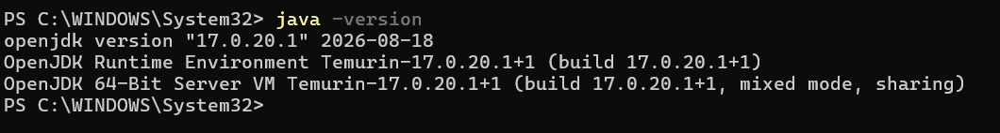

*Figure 1 : `java -version`, `javac -version` et `JAVA_HOME` dans PowerShell.*

**Vérification de Git** : `git --version` confirme l'installation, et l'identité de l'auteur ainsi que la branche par défaut `main` ont été définies avec `git config`.

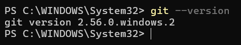

*Figure 2 : installation et configuration de Git.*

---

## 3. Création du projet

### 3.1 Projet Maven `TP1`

IntelliJ IDEA → *New Project* → **Java** → système de build **Maven** → JDK **17** → nom `TP1` (GroupId `org.example`, ArtifactId `TP1`). L'option « Add sample code » est décochée, car le TP n'utilise pas de classe `Main` générée.


*Figure 3 : écran d'accueil d'IntelliJ IDEA 2026.2.3.*

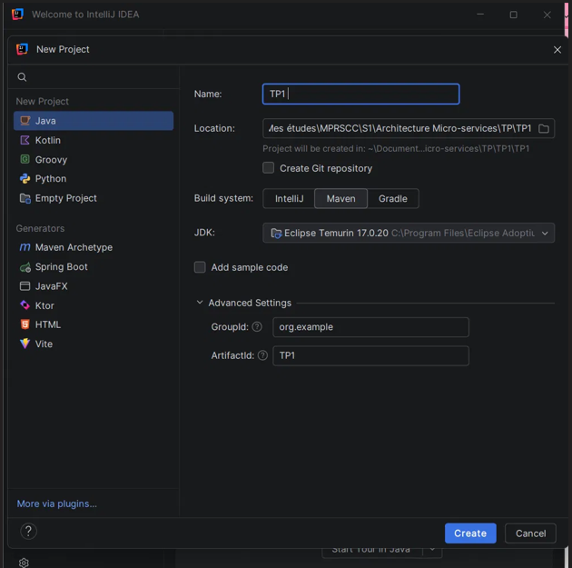

*Figure 4 : fenêtre de création du projet (Maven, JDK 17, GroupId `org.example`, ArtifactId `TP1`).*

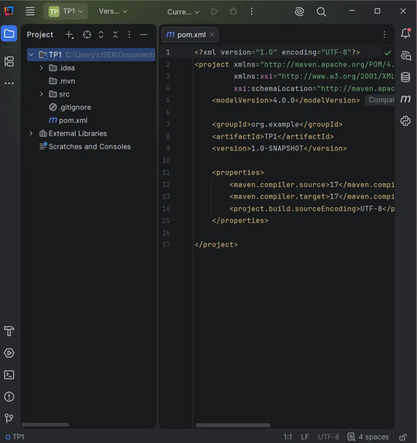

*Figure 5 : projet créé, avec le `pom.xml` initial (compilation en Java 17, encodage UTF-8).*

### 3.2 Les packages

Trois packages sont créés dans `src/main/java` : `dao` (accès aux données), `metier` (logique de calcul) et `presentation` (point d'entrée). Le dossier `src/main/resources` contient les fichiers de configuration.

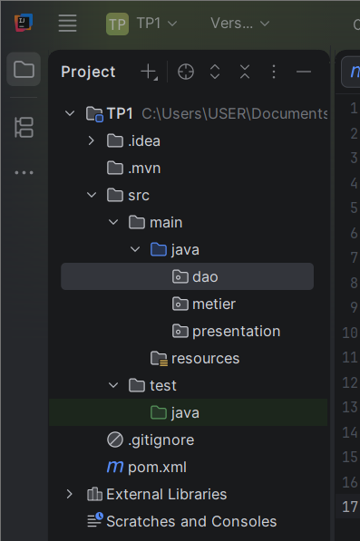

*Figure 6 : packages `dao`, `metier`, `presentation` et dossier `resources`.*

### 3.3 Structure finale du projet

```
TP1
├── pom.xml
├── images/                         (captures d'écran du compte rendu)
└── src/main
    ├── java
    │   ├── dao            IDao.java, DaoIMP.java
    │   ├── metier         IMetier.java, MetierIMP.java
    │   └── presentation   PresentationStatique.java
    │                      PresentationDynamique.java
    │                      PresentationAvecSpring.java
    │                      PresentationAvecAnnotation.java
    └── resources          config.txt, config.xml
```

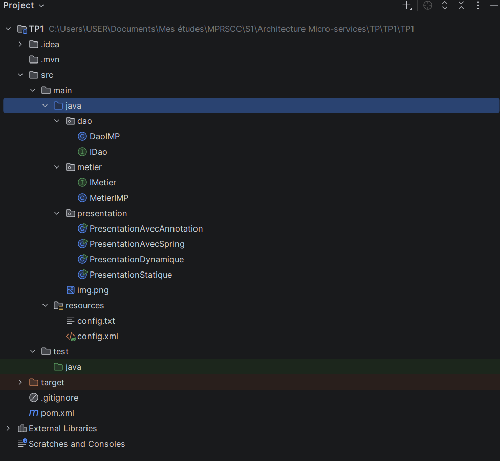

*Figure 7 : arborescence finale du projet dans IntelliJ.*

---

## 4. Activité 1-1 : injection par instanciation statique

**Objectif** : explorer le couplage faible avec une injection faite à la main.

### 4.1 Les interfaces et les classes

`dao/IDao.java`

```java
package dao;

public interface IDao {
    double getValue();
}
```

`dao/DaoIMP.java`

```java
package dao;

public class DaoIMP implements IDao {
    @Override
    public double getValue() {
        return 3; // simulation d'un accès aux données
    }
}
```

`metier/IMetier.java`

```java
package metier;

public interface IMetier {
    double calcul();
}
```

`metier/MetierIMP.java`

```java
package metier;

import dao.IDao;

public class MetierIMP implements IMetier {

    private IDao dao; // dépendance vers l'interface (couplage faible)

    @Override
    public double calcul() {
        return dao.getValue() * 7;
    }

    // Setter utilisé pour l'injection
    public void setDao(IDao dao) {
        this.dao = dao;
    }
}
```

`MetierIMP` ne dépend que de l'**interface** `IDao`, jamais de `DaoIMP`.

| | |
|---|---|
| 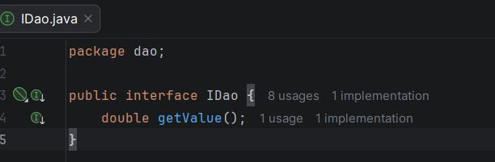 | 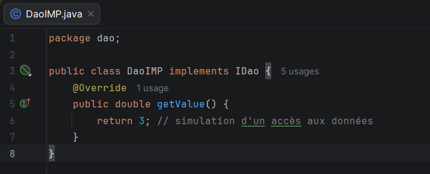 |
| 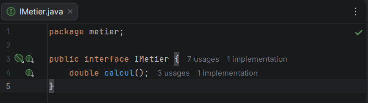 | 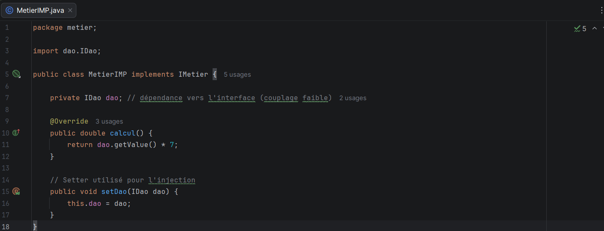 |

*Figure 8 : les interfaces `IDao` et `IMetier` et les classes `DaoIMP` et `MetierIMP`.*

### 4.2 La classe `PresentationStatique`

```java
package presentation;

import dao.DaoIMP;
import metier.MetierIMP;

public class PresentationStatique {
    public static void main(String[] args) {
        DaoIMP dao = new DaoIMP();          // instanciation statique du DAO
        MetierIMP metier = new MetierIMP(); // instanciation statique du métier

        metier.setDao(dao);                 // injection de dépendance

        System.out.println(metier.calcul());
    }
}
```

### 4.3 Exécution

Résultat obtenu : `21.0` (3 × 7), avec `Process finished with exit code 0`.

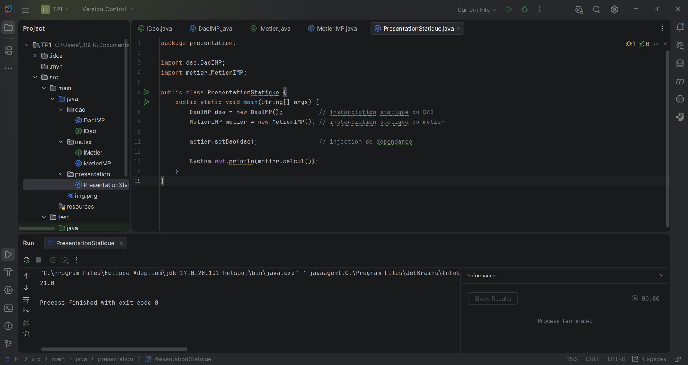

*Figure 9 : exécution de `PresentationStatique`.*

### 4.4 Questions

**9. Comment cela illustre-t-il le couplage faible ?**
`MetierIMP` ne connaît que l'interface `IDao`, c'est-à-dire un contrat (`getValue()`), et non l'implémentation `DaoIMP`. On peut fournir une autre implémentation de `IDao` (par exemple une classe qui lit une base de données) sans modifier une seule ligne de `MetierIMP`. Sans l'injection, `dao` vaudrait `null` et `calcul()` lèverait une `NullPointerException`.

**10. Le principe d'inversion de contrôle est-il respecté ?**
Non. La dépendance est bien injectée de l'extérieur (c'est de l'injection de dépendances), mais c'est la classe `PresentationStatique` qui crée les objets avec `new` et les assemble. Le contrôle reste dans le code du programmeur, il n'est pas inversé.

**11. Que faut-il modifier pour que la présentation ne contrôle plus la création des objets ?**
Il faut sortir le choix des classes et leur assemblage du code de présentation : d'abord vers un fichier de configuration lu à l'exécution (activité 1-2), puis vers un conteneur qui crée et assemble les objets (Spring, activités 1-3 et 1-4).

---

## 5. Activité 1-2 : injection par instanciation dynamique

**Objectif** : choisir les classes à partir de noms lus dans un fichier de configuration.

### 5.1 Le fichier `config.txt`

Placé dans `src/main/resources` :

```
dao.DaoIMP
metier.MetierIMP
```

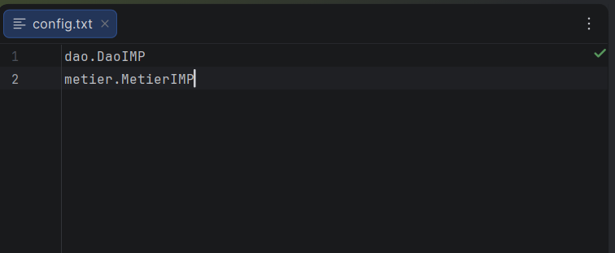

*Figure 10 : le fichier `config.txt`.*

### 5.2 La classe `PresentationDynamique`

```java
package presentation;

import dao.IDao;
import metier.IMetier;

import java.io.BufferedReader;
import java.io.InputStreamReader;
import java.lang.reflect.Method;

public class PresentationDynamique {
    public static void main(String[] args) throws Exception {

        // 1. Lire config.txt depuis le classpath
        BufferedReader br = new BufferedReader(
                new InputStreamReader(
                        PresentationDynamique.class
                                .getClassLoader()
                                .getResourceAsStream("config.txt")));

        String daoClassName = br.readLine();     // dao.DaoIMP
        String metierClassName = br.readLine();  // metier.MetierIMP
        br.close();

        // 2. Chargement dynamique des classes et création des instances
        Class<?> cDao = Class.forName(daoClassName);
        IDao dao = (IDao) cDao.getDeclaredConstructor().newInstance();

        Class<?> cMetier = Class.forName(metierClassName);
        IMetier metier = (IMetier) cMetier.getDeclaredConstructor().newInstance();

        // 3. Injection par réflexion : appel de setDao(IDao)
        Method setDao = cMetier.getMethod("setDao", IDao.class);
        setDao.invoke(metier, dao);

        // 4. Utilisation
        System.out.println(metier.calcul());
    }
}
```

### 5.3 Exécution

Résultat obtenu : `21.0`, avec `exit code 0`.

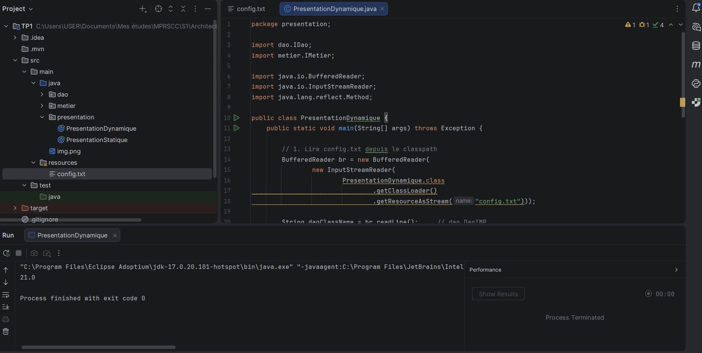

*Figure 11 : exécution de `PresentationDynamique`.*

### 5.4 Questions

**7. Comment cela illustre-t-il l'injection par instanciation dynamique ?**
Le code Java ne contient plus aucun `new DaoIMP()` ni `new MetierIMP()`. Les noms de classes sont lus dans `config.txt`, les classes sont chargées avec `Class.forName`, instanciées par réflexion, puis `setDao` est appelée avec `invoke` : l'objet est injecté sans que le code connaisse les classes concrètes.

**8. En quoi cette approche se rapproche-t-elle davantage de l'IoC que l'activité 1-1 ?**
Le choix des classes ne se trouve plus dans le code, mais dans la configuration. Pour changer d'implémentation, il suffit de modifier `config.txt`, sans recompiler. Ce n'est cependant pas une IoC complète : c'est encore notre `main` qui lit le fichier, instancie et assemble.

**9. Avantages et limites ?**

- *Avantages* : aucun nom de classe concrète dans le code, pas de recompilation pour changer d'implémentation, application plus extensible.
- *Limites* : les erreurs (nom de classe faux, méthode introuvable) ne sont détectées qu'à l'exécution, le code de réflexion est lourd à écrire, et ni la gestion de plusieurs dépendances ni le cycle de vie des objets ne sont pris en charge : c'est au programmeur de les écrire.

---

## 6. Activité 1-3 : injection avec Spring et un fichier XML

**Objectif** : confier la création et l'assemblage des objets au conteneur Spring, configuré par un fichier XML.

### 6.1 Les dépendances Maven

Dans le `pom.xml`, les dépendances `spring-core`, `spring-beans` et `spring-context` sont déclarées avec la version 7.0.8 :

```xml
<properties>
    <maven.compiler.source>17</maven.compiler.source>
    <maven.compiler.target>17</maven.compiler.target>
    <project.build.sourceEncoding>UTF-8</project.build.sourceEncoding>
    <spring.version>7.0.8</spring.version>
</properties>

<dependencies>
    <dependency>
        <groupId>org.springframework</groupId>
        <artifactId>spring-core</artifactId>
        <version>${spring.version}</version>
    </dependency>
    <dependency>
        <groupId>org.springframework</groupId>
        <artifactId>spring-beans</artifactId>
        <version>${spring.version}</version>
    </dependency>
    <dependency>
        <groupId>org.springframework</groupId>
        <artifactId>spring-context</artifactId>
        <version>${spring.version}</version>
    </dependency>
</dependencies>
```

Après le chargement de Maven, les bibliothèques Spring apparaissent dans *External Libraries*.

| | |
|---|---|
| 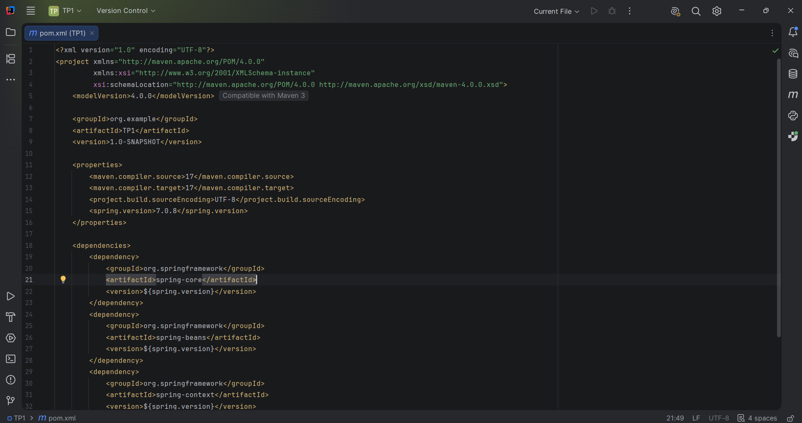 | 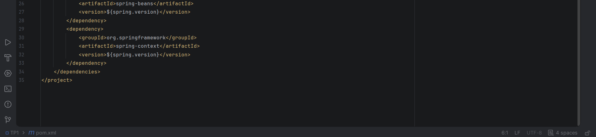 |

*Figure 12 : le fichier `pom.xml` (début, puis fin).*

### 6.2 Le fichier `config.xml`

Placé dans `src/main/resources` (le sujet parle de « package ressource » : il s'agit du dossier standard Maven `resources`) :

```xml
<?xml version="1.0" encoding="UTF-8"?>
<beans xmlns="http://www.springframework.org/schema/beans"
       xmlns:xsi="http://www.w3.org/2001/XMLSchema-instance"
       xsi:schemaLocation="http://www.springframework.org/schema/beans
       https://www.springframework.org/schema/beans/spring-beans.xsd">

    <!-- Bean DAO -->
    <bean id="dao" class="dao.DaoIMP"/>

    <!-- Bean métier, avec injection du DAO par le setter setDao() -->
    <bean id="metier" class="metier.MetierIMP">
        <property name="dao" ref="dao"/>
    </bean>
</beans>
```

### 6.3 La classe `PresentationAvecSpring`

```java
package presentation;

import metier.IMetier;
import org.springframework.context.ApplicationContext;
import org.springframework.context.support.ClassPathXmlApplicationContext;

public class PresentationAvecSpring {
    public static void main(String[] args) {
        ApplicationContext context =
                new ClassPathXmlApplicationContext("config.xml");

        IMetier metier = context.getBean("metier", IMetier.class);
        System.out.println(metier.calcul());
    }
}
```

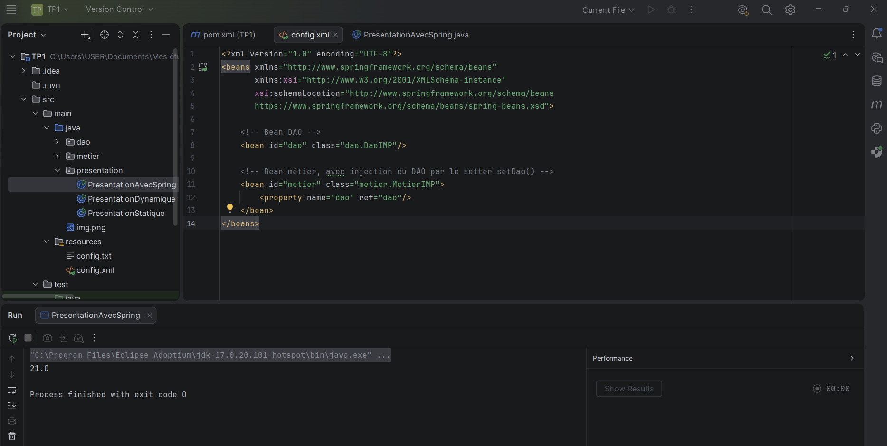

*Figure 14 : le fichier `config.xml`.*

### 6.4 Exécution

Résultat obtenu : `21.0`, avec `exit code 0`.

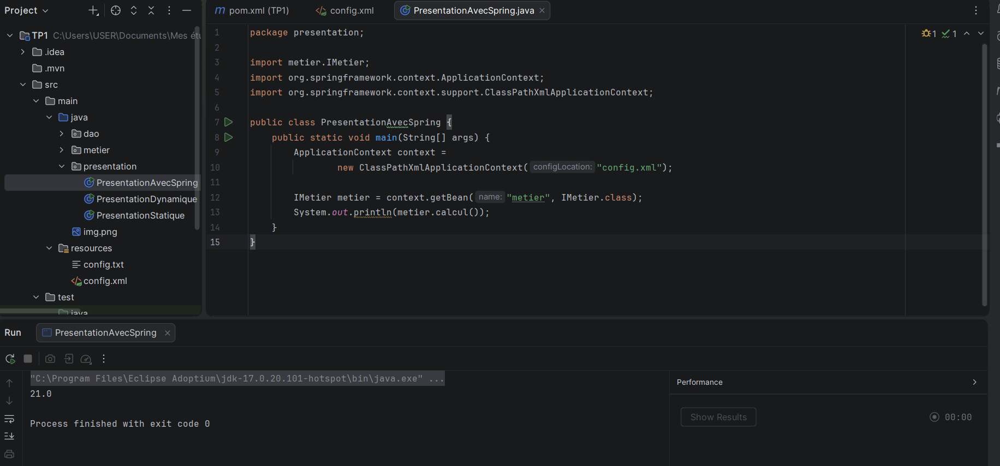

*Figure 15 : exécution de `PresentationAvecSpring`.*

### 6.5 Questions

**6. Comparaison avec l'activité 1-2 (gestion des dépendances).**
En 1-2, nous écrivons nous-mêmes la lecture du fichier, la réflexion et l'injection. En 1-3, Spring lit une configuration structurée (`<bean>`, `<property>`) et se charge de la création, de l'injection et du cycle de vie des objets. Le code de présentation se réduit à `getBean`.

**7. Différence entre création manuelle, par réflexion et par le conteneur Spring.**

- *Création manuelle* (`new`) : simple, mais l'objet est fortement couplé à la classe concrète choisie dans le code.
- *Création par réflexion* (`Class.forName`) : la classe est choisie à l'exécution à partir d'un fichier, mais tout le travail d'instanciation et d'injection reste dans notre code.
- *Création par le conteneur Spring* : le conteneur lit la configuration, crée les beans et les assemble. Le contrôle est inversé : ce n'est plus le programme qui pilote la création des objets, c'est le conteneur (IoC).

---

## 7. Activité 1-4 : injection avec Spring et des annotations

**Objectif** : supprimer le fichier de configuration et laisser Spring détecter les classes et assembler les objets.

### 7.1 Les classes annotées

`dao/DaoIMP.java`

```java
package dao;

import org.springframework.stereotype.Repository;

@Repository
public class DaoIMP implements IDao {
    @Override
    public double getValue() {
        return 3;
    }
}
```

`metier/MetierIMP.java`

```java
package metier;

import dao.IDao;
import org.springframework.beans.factory.annotation.Autowired;
import org.springframework.stereotype.Service;

@Service
public class MetierIMP implements IMetier {

    @Autowired
    private IDao dao;

    @Override
    public double calcul() {
        return dao.getValue() * 7;
    }

    // Conservé pour que les activités 1-1 à 1-3 continuent de fonctionner
    public void setDao(IDao dao) {
        this.dao = dao;
    }
}
```

| | |
|---|---|
| 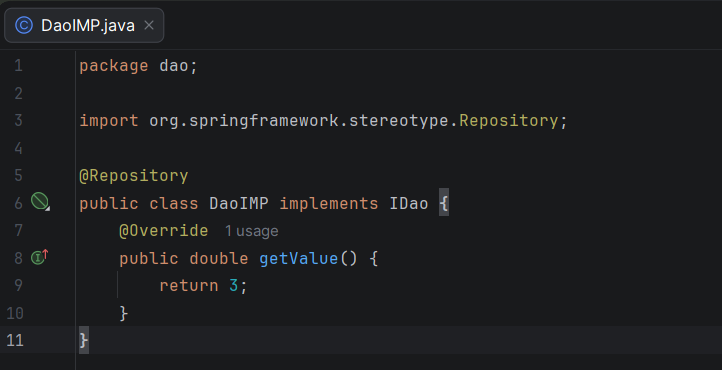 | 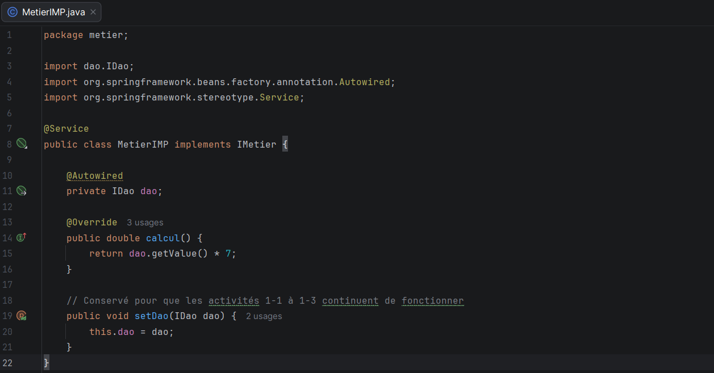 |

*Figure 16 : `DaoIMP` (`@Repository`) et `MetierIMP` (`@Service`, `@Autowired`).*

### 7.2 La classe `PresentationAvecAnnotation`

```java
package presentation;

import metier.IMetier;
import org.springframework.context.ApplicationContext;
import org.springframework.context.annotation.AnnotationConfigApplicationContext;

public class PresentationAvecAnnotation {
    public static void main(String[] args) {
        // Scan des packages contenant les classes annotées
        ApplicationContext context =
                new AnnotationConfigApplicationContext("dao", "metier");

        IMetier metier = context.getBean(IMetier.class);
        System.out.println(metier.calcul());
    }
}
```

### 7.3 Exécution

Résultat obtenu : `21.0`, avec `exit code 0`. Ici, le fichier `config.xml` n'est pas utilisé.

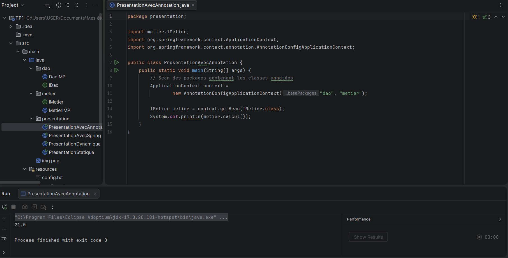

*Figure 17 : exécution de `PresentationAvecAnnotation`.*

### 7.4 Questions

**5. Comment Spring gère-t-il l'injection avec les annotations ?**
`AnnotationConfigApplicationContext("dao", "metier")` scanne ces packages à la recherche de classes marquées par un stéréotype (`@Repository`, `@Service`). Chaque classe trouvée devient un bean géré par Spring : `@Repository` désigne la couche d'accès aux données, `@Service` la couche métier. `@Autowired` sur l'attribut `dao` demande à Spring d'injecter le bean dont le type correspond à `IDao`, ici `DaoIMP`.

**6. Pourquoi cette solution est-elle plus maintenable que le XML, et en quoi représente-t-elle une application complète de l'IoC ?**
La configuration est portée par le code, à côté de la classe concernée : il n'y a plus de fichier XML à garder synchronisé ni de nom de classe écrit sous forme de chaîne, donc moins de risques d'erreur. Chaque classe déclare ce dont elle a besoin (`@Autowired`) et le conteneur fournit tout : il détecte, crée et assemble les objets. Le programmeur n'écrit plus ni `new`, ni lecture de configuration, ni appel à `setDao` : le contrôle est entièrement inversé.

---

## 8. Synthèse

| Activité | Création des objets | Choix de l'implémentation | Pour changer de DAO |
|---|---|---|---|
| 1-1 Statique | `new` dans `main` | Dans le code Java | Modifier le code et recompiler |
| 1-2 Dynamique | Réflexion dans `main` | Dans `config.txt` | Modifier une ligne du fichier |
| 1-3 Spring XML | Conteneur Spring | Dans `config.xml` | Modifier `config.xml` |
| 1-4 Annotations | Conteneur Spring | Sur la classe (`@Repository`) | Déplacer l'annotation sur l'autre classe |

**À retenir** : couplage faible (dépendre d'interfaces) → injection de dépendances (recevoir sa dépendance de l'extérieur) → inversion de contrôle (un conteneur crée et assemble les objets).

---

## 9. Difficultés rencontrées

- **Faute dans le nom d'un package** : le package `dao` avait été nommé `deo` à la création. Il a été corrigé avec *Refactor → Rename* avant d'écrire la moindre classe.
- **Fichier parasite** : une image (`img.png`) avait été collée dans `src/main/java`. Elle a été sortie du code source.
- **Commandes Git lancées dans le mauvais dossier** : `git init` a d'abord été exécuté depuis `C:\WINDOWS\System32`, ce que Windows a refusé (`Permission denied`), sans rien créer. Les commandes ont été relancées après un `cd` vers le dossier du projet.
- **Dossier `.idea` non ignoré** : le premier `git status` montrait le dossier de configuration d'IntelliJ comme fichier à publier. Les lignes `.idea/` et `*.iml` ont été ajoutées au `.gitignore` avant le premier commit.
- **Historiques différents** : le dépôt GitHub contenait déjà un README initial. Il a été fusionné avec `git pull origin main --allow-unrelated-histories` avant le premier `git push`.

---

## 10. Reproduire le projet

1. Installer le **JDK 17** et **IntelliJ IDEA**.
2. Cloner le dépôt :

```bash
git clone https://github.com/Amalkaraoud/TP1-MS.git
```

3. Ouvrir le dossier dans IntelliJ IDEA (le projet est reconnu comme projet Maven), puis vérifier que le JDK du projet est la version 17.
4. Laisser Maven télécharger les dépendances Spring.
5. Exécuter chacune des classes `main` du package `presentation` (`PresentationStatique`, `PresentationDynamique`, `PresentationAvecSpring`, `PresentationAvecAnnotation`) : chacune affiche `21.0`.

---

## 11. Conclusion

Ce TP a montré, sur le même exemple (`IDao`, `IMetier`, résultat `21.0`), l'évolution de l'assemblage des objets : de l'instanciation manuelle à l'injection par le conteneur Spring. Il a permis de comprendre :

- le **couplage faible**, obtenu en dépendant d'interfaces ;
- l'**injection de dépendances**, où un objet reçoit sa dépendance de l'extérieur ;
- l'**inversion de contrôle**, où un conteneur (Spring) crée et assemble les objets à partir d'un fichier XML ou d'annotations ;
- l'utilisation de **Maven** pour gérer les dépendances et de **Git/GitHub** pour publier le travail.
